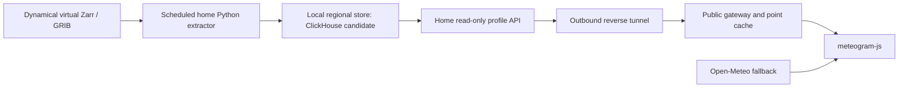

# Arbitrary US locations from a home forecast server

> Historical record. Measurements, commands and deployment status below apply to
> the recorded version. See the [current native service guide](../../native/README.md)
> for supported formats, commands and deployed behavior.

Design date: 2026-10-17. The user wants arbitrary coordinates, initially in the
continental US, and has a spare Linux computer. Interpret the initial coverage
as the contiguous lower 48 (CONUS); Alaska and Hawaii are outside this first
ingestion region. This is a design, not an implemented backend or provider switch.

This supersedes the five-location restriction and static-only backend in the
[earlier cost design](2026-10-16-dynamical-cost-design.md). The scientific caveats
and model eligibility in the [source investigation](2026-10-14-dynamical-migration.md)
still apply.

Prototype update: [measured ClickHouse results](2026-10-17-clickhouse-prototype-results.md)
now cover real HRRR tiles, layout comparisons and an arbitrary-coordinate API.
Full-region and full-horizon sizing remains extrapolated; workspace network
failures limited source acquisition to four forecast times.

## Recommendation

Ingest every native grid cell in the supported region on the home computer.
Serve arbitrary coordinates from that local store, with a small public API and
a cache of requested point forecasts. **No location request starts a Dynamical
download.** A new location can be answered even if nobody has queried it before.

Self-hosted ClickHouse is a reasonable serving-store candidate now. Use one
instance, short retention and a point-oriented sort key. There is no need for
ClickHouse Cloud, a cluster, Kafka or a long-lived global archive. ClickHouse
organizes the decoded data for later queries; it does not avoid source downloads
or full-map decoding.

A materialized local Zarr store with chunks containing a small spatial tile and
many times/levels is also a strong candidate for this dense, point-profile
workload. Arbitrary locations do not intrinsically require SQL. Benchmark that
layout against ClickHouse before committing to a full-domain deployment; choose
based on ingestion cost, disk amplification and cold point-query latency.

## Architecture



The Linux computer runs extraction, local storage and the API. Use systemd
services/timers and a small SQLite ingestion ledger. Bound ingestion concurrency
and database background work so ingestion cannot starve queries. The API is the
only public operation surface; ClickHouse listens locally. A reverse tunnel
avoids home router port forwarding. The tunnel, gateway and domain configuration
still need to be selected and validated for deployment.

Cloud storage holds only requested/popular profiles, not the regional database.
R2 and a minimal Worker remain suitable within their free allowances, with
bounded cache admission and expiry. Uncached requests depend on the home machine
and home uplink. Cached profiles can survive a home outage until their freshness
limit; other requests use the existing provider. This is a real availability
tradeoff compared with the earlier static-only design.

## Coverage and query semantics

- Start with a generous GFS/AIFS rectangle: 24–50°N, 125–66°W. It contains
  24,885 cells at the observed 0.25° spacing, before any interpolation halo.
  This is a storage rectangle, not an exact US border mask.
- HRRR uses its native projected grid. Crop by geographic coverage while retaining
  original grid indices; retaining the entire native HRRR domain is a simpler,
  larger first implementation. Never round HRRR to a latitude/longitude grid.
- Map requested coordinates to the nearest native cell. This provides arbitrary
  coordinates at model resolution: approximately 3 km for HRRR and 0.25° for
  these GFS/AIFS products. It does not create meter-scale forecasts.
- Reject out-of-coverage coordinates before selecting a boundary cell. Return
  requested coordinates, selected grid coordinates, grid version and source run.
  Normalize longitude; derive lookup indices from actual coordinate metadata.
- Bilinear interpolation is a later option that reads neighboring cells. It
  needs an ingestion halo and rules for missing values and vector winds. Start
  with nearest-cell behavior so native values remain directly verifiable.
- Unsupported models and locations outside the retained region continue through
  Open-Meteo. For supported locations, missing/incomplete/stale local runs also
  fall back as a whole response, with the actual source disclosed.

Resolve coordinates through a lightweight grid endpoint, then fetch a profile
using `(dataset/grid version, published revision, cell_id, profile schema)` as
the canonical cache key. This shares cached data across nearby requests without
keying storage by arbitrary user-provided decimal strings. Only accept cell IDs
inside published coverage. The public gateway can serve cached profiles directly;
cache misses call the home API. Keep coordinate resolution separate from profile
generation so it can later move to the edge if useful.

Cache source-cell values and source metadata. Apply requested-coordinate terrain
lookup and latitude-dependent height conversion separately; do not put one
request's terrain or latitude-derived results in a shared cell cache.

## Ingest once, retain the regional grid

1. Pin one dataset version, Icechunk snapshot and model initialization. Resolve
   the required native lead times and pressure levels, including publication lag.
2. Fetch/decode each required source map once with bounded concurrency. Crop the
   decoded map immediately and persist regional staging data. Cropping reduces
   retained bytes, but these source chunks still require full-map fetch/decode.
3. Store Float32 values initially, checking numerical error against source
   precision and preserving missing-value masks. Keep field units, level order,
   cloud-estimation method and HRRR wind orientation explicit. Do not store every
   renderer-derived quantity or silently quantize to lower precision.
4. Checkpoint completed lead times across the retained region. Assemble output
   in bounded spatial batches across those staged times so each batch contains
   contiguous cell histories. Never load a full run into RAM or open one file per
   scalar. Account for temporary transpose files as well as final storage.
5. Load a new, unpublished revision, validate expected coverage and values, then
   atomically switch a small published manifest. Requests pin that revision for
   their entire response; do not infer readiness from the maximum initialization.
6. Retain the active complete run and one previous complete run, plus bounded
   staging for one new run per model. Remove obsolete partitions only after
   in-flight requests/manifest cache leases expire. Skip obsolete queued runs
   instead of accumulating a permanent ingestion backlog.

Aim for each supported six-hourly cycle only after measuring total work on the
actual computer. Run age and remaining horizon must govern publication. Forty
HRRR steps are insufficient to promise 40 hours from now throughout a cycle;
ingesting its full 0–48h run means 49 hourly times. Likewise GFS/AIFS need leads
beyond 168h when serving seven days from request time. Native time cadence and
available levels remain visible; interpolating adds no new model information.

## ClickHouse layout and query

Use a separate table per model/grid schema. A practical initial row is one
`(revision, cell_id, lead_hour)` with separate `Array(Float32)` columns for each
vertical variable; array positions correspond to the run's pressure-level list.
Surface temperature/dew point are scalar columns in the same row. Keep pressure
coordinates, projection and dataset metadata in a small revision catalog.

The important physical layout is:

```text
PARTITION BY revision_id
ORDER BY (cell_id, lead_hour)
```

There will be only a few retained revisions per model, not a partition per cell.
Query a pinned partition and exact cell, with the bounded time range:

```sql
SELECT lead_hour, temperature, geopotential_height, wind_u, wind_v,
       relative_humidity, dew_point_temperature, temperature_2m, dew_point_2m
FROM hrrr_profiles
WHERE revision_id = {revision:UInt64}
  AND cell_id = {cell:UInt32}
  AND lead_hour BETWEEN {first:UInt16} AND {last:UInt16}
ORDER BY lead_hour
```

This illustrates the proposed HRRR schema, not executable repository code.
GFS/AIFS have different native variable sets. Derive wind direction, humidity,
cloud estimates and chart geometry consistently with the source investigation.

ClickHouse has a sparse primary index, not a row-level index. Its default
8,192-row granules can read many neighboring cells for a small point query.
Benchmark smaller granules (for example, 256 or 512 rows), compressed block sizes
and actual bytes read; do not promise low latency merely because the key exists.
Cold and warm latency while ingestion runs are both acceptance measurements.

Bulk-load sorted spatial batches spanning the selected forecast times. Avoid
one insert per level/cell or thousands of overlapping parts that depend on costly
merges to become queryable efficiently. Use bounded typed/binary batches, and
measure active parts, sorting/merging memory, bytes written and insert throughput.
Avoid routine `OPTIMIZE FINAL` as an ingestion requirement.

For an ambiguous failed insert, do not blindly retry and assume the primary key
enforces uniqueness. Build a fresh unpublished attempt or clear/rebuild the failed
attempt from local staging; validate row counts and unique `(cell_id, lead_hour)`
keys before publication. ReplacingMergeTree background deduplication alone is not
a publication correctness guarantee.

Expose fixed parameterized API queries only, with bounded time/level ranges,
concurrency and timeouts. Users cannot submit arbitrary SQL. Popular-point caches
reduce read traffic, but every ingested cell must work without a cache hit.

## Storage and recurring costs

The following are arithmetic estimates from observed source grid dimensions and
the representative selections in the investigation. They count **only Float32
pressure-level values**, not disk compression, database overhead, staging, surface
data, indexes, RAM or network downloads.

| Selection                                              |     Cells | Times × levels × fields | Values per run |
| ------------------------------------------------------ | --------: | ----------------------: | -------------: |
| GFS US bounding box                                    |    24,885 |            137 × 30 × 6 |       2.29 GiB |
| HRRR entire native domain (conservative spatial bound) | 1,905,141 |             40 × 30 × 6 |      51.10 GiB |
| AIFS US bounding box                                   |    24,885 |              29 × 8 × 5 |       0.11 GiB |
| Total representative selection                         |           |                         |      53.49 GiB |

Formula: `cells × times × levels × fields × 4 / 2^30` GiB. Using all 49 HRRR
times raises its row to **62.60 GiB**. Cropping HRRR reduces it; longer GFS/AIFS
horizons increase their rows. No compression ratio has been measured.

Two completed runs plus a staging copy are approximately 160 GiB for the
representative selection before overhead and additional build/merge copies.
Thus the earlier small-RAM point-extractor sizing no longer establishes the
requirements. An existing 16–32 GiB RAM machine with a 500 GB–1 TB SSD is a
reasonable benchmark candidate, not a capacity guarantee or a recommendation to
buy hardware. Streaming keeps RAM below full-run size; measured peak disk use
must leave headroom for concurrent publication and cleanup.

Four representative cycles per day process about **6.3 TiB/month of Float32 value
output before compression**. Actual SSD writes include staging and merges and
must be measured; actual Internet downloads are compressed GRIB bytes and are a
different quantity. A source-read counter is essential before assuming a home
data cap is sufficient. Cropping global source maps does not shrink those GRIB
downloads.

Self-hosted ClickHouse has no service subscription. At $0.25/kWh, a dedicated
machine averaging 20/40/80 W costs about $3.60/$7.20/$14.40 per 30-day month in
electricity. Use measured average wall power including idle time; an already-on
machine may have lower incremental consumption. SSD wear, home connectivity and
maintenance remain costs. R2/Workers can stay within free allowances at small
traffic, but cache size and request volume must be bounded, and a domain/tunnel
may have separate costs. Keep the regional database off R2 initially.

## Acceptance and rollout

1. Use HRRR, the default app model, for a bounded full-horizon spatial-tile pilot.
   Compare ClickHouse and materialized point-oriented Zarr on identical values.
   Record source bytes, CPU/wall time, peak RAM, peak disk, disk writes, ingest
   throughput and cold/warm point-query latency during the next ingestion.
2. Verify randomly selected coordinates never queried before, including coastal
   and mountain locations and domain edges. Compare sampled values directly with
   Dynamical; verify masks, projected indices, wind rotation and native cadence.
3. Choose the simpler store that meets measured requirements. Target sub-second
   local profile reads as a pilot goal, not a measured result. Then benchmark a
   complete retained region: a small tile still pays the same source-map reads
   but understates database loading and storage costs.
4. Test interruption/resume, ambiguous writes, incomplete runs, atomic manifest
   changes, disk limits and home outages. Serve only complete revisions, with a
   whole-response fallback. Add GFS and AIFS within measured six-hour cycle and
   home bandwidth/storage capacity.
5. Integrate the provider behind a per-model switch in meteogram-js. Preserve
   existing arbitrary-coordinate URLs, source/run disclosure, scientific
   transforms and a one-setting rollback. No backend is deployed by this design.

## References

- [ClickHouse sparse primary indexes](https://clickhouse.com/docs/primary-indexes)
- [MergeTree ordering, partitions and granules](https://clickhouse.com/docs/engines/table-engines/mergetree-family/mergetree)
- [ClickHouse bulk inserts](https://clickhouse.com/docs/optimize/bulk-inserts)
- [Zarr chunk shape and sharding guidance](https://zarr.readthedocs.io/en/stable/user-guide/performance/)
- [Earlier cost design and provider pricing sources](2026-10-16-dynamical-cost-design.md)

Storage arithmetic was recalculated and the linked ClickHouse/Zarr layout
guidance checked on 2026-10-17. Full-grid ingest/query benchmarks remain undone.
