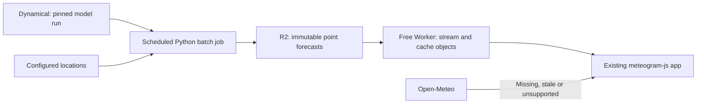

# Near-zero-cost Dynamical ingestion and serving

Design date: 2026-10-16. This is a design, not a deployment or a provider switch.
It builds on [the live investigation](2026-10-14-dynamical-migration.md).

Update, 2026-10-17: the user now requires arbitrary coordinates in the continental
US and can dedicate a home Linux computer. The
[regional serving design](2026-10-17-dynamical-arbitrary-locations.md) supersedes
this document's five-site restriction and static-only backend. The pricing below
remains reference material; its tiny point-store sizing does not size a regional
database.

## Recommendation

Use a **bounded, scheduled batch extractor that publishes static point forecasts**.
Keep Open-Meteo for unsupported models, uncached locations, stale/incomplete
snapshots, and periods when the ingestion budget is exhausted. Page visits must
never start extraction.

The target is approximately **$0 incremental monthly infrastructure cost**. This
does not guarantee a complete replacement of all three supported models at every
model cycle. At the current near-zero baseline, a new server or global archive
needs a benefit beyond cost. Engineering and maintenance still cost time even
when hosting fits within free allowances.

Start with the five configured locations. Preserve the vertical range and native
source resolution; measure a complete batch before choosing its frequency.
Support GFS, HRRR and AIFS in the architecture, enabling each when it fits the
budget. Do not silently reduce resolution to meet a cost estimate.

## Architecture



There is no continuously running API server, request queue, Redis or relational
database. Python terminates when extraction finishes. Serving only reads files.

- **Initial runner:** an existing computer, if available. It only needs outbound
  access. This avoids new cloud compute charges; electricity, connectivity and
  availability are not free.
- **Managed runner:** one Cloud Run Job in `us-central1`, initially 2 vCPUs and
  2 GiB RAM, invoked by one Cloud Scheduler definition. No idle compute charge.
  Compare allocated vCPU-seconds on 1 versus 2 CPUs during the pilot: network
  waits still count as billed allocation.
- **Storage/serving:** R2 Standard and a minimal Workers Free reader. Keep R2
  private; stream published paths through the Worker with CORS/cache headers.
  The Worker does no meteorology, decoding or ingestion. An existing Cloudflare
  custom domain can serve objects directly later. Do not use the rate-limited
  `r2.dev` development endpoint as the production origin.

## Decode once for all locations

The expensive unit is a source chunk. For the tested stores, that is one time,
one pressure level and a full spatial map. For each required chunk:

1. Fetch and decode it once.
2. Gather values for **all configured grid points**.
3. Retain those small vectors and release the map.

Do not run the single-point probe independently for each airport. An explicit
decode/gather loop guarantees reuse. Vectorized Xarray indexing is an alternative
only after verifying that it reads each chunk once. Deduplicate sites mapping to
the same grid cell.

The representative GFS selection requires 24,660 profile chunks for one airport
or all five. Even 100 configured locations need the same source chunks, although
gathering, encoding and output size increase. This amortizes ingestion; it does
not eliminate the substantial baseline work.

Stream with bounded global concurrency, initially four chunk reads. Never load
the entire forecast into RAM, persist decoded maps, or retain raw GRIB files.

## Ingestion and publication

- Resolve STAC and pin one Icechunk snapshot/run for all fields. Skip complete
  published runs. Precompute grid indices and HRRR projection/wind rotation.
- Apply the field/unit conventions from the investigation, including explicit
  humidity-derived cloud estimates for HRRR/AIFS. Preserve terrain lookup and
  latitude-dependent height conversion.
- Checkpoint **one completed forecast time across all sites and fields**. An
  object per scalar/chunk would create unnecessary writes. Checkpoints allow a
  timed-out job to resume without downloading completed source chunks again.
- Key objects by dataset version, run/snapshot, extractor version and location
  list hash. Adding locations can require re-extraction; a single new site must
  not automatically trigger a global read.
- Validate time coverage, dimensions, units, projection and finite values with
  documented missing/below-ground masks. Missing chunks must not become zero
  cloud or wind.
- Upload immutable point files, then update the small manifest **last**. Readers
  see only complete snapshots. Use conditional writes/leases so duplicates do
  not repeat expensive work or overwrite newer publication.
- Keep seven days of snapshots and at most 48 hours of staging data, subject to
  referenced-object cache lifetimes. Discard staging that is already too stale
  to meet the forecast policy. Use lifecycle cleanup.

```text
v1/<model>/<run>/<revision>/grid-<cell>.json
v1/latest/<model>.json
staging/<model>/<run>/<revision>/lead-<hour>.json
```

Publish compact columnar JSON with gzip transport encoding. Include native times,
levels, requested/grid coordinates, source/run metadata, units, cloud method,
attribution and schema version. A shared TypeScript transform computes the
renderer-specific geometry and derived fields. Another Zarr store is unnecessary
for these small point products.

Target **512 KiB encoded per location/model snapshot** as a conservative payload
cap to verify, not a measured output size. Cache manifests for 2–5 minutes and
versioned payloads immutably. Replace the current full forecast refresh every
minute with a manifest check; fetch another payload only when its version changes.
SSR can read the same objects. Browser refreshes can read them directly without
an additional Vercel compute hop.

## Coverage and freshness

Start with the five sites in `LOCATIONS`. Custom coordinates use Open-Meteo unless
their exact nearest source grid cell is present. Do not substitute another
airport's weather. Add popular sites in reviewed batches, without letting user
traffic create unlimited extraction work or coordinate storage.

The eventual supported Dynamical routes are GFS, HRRR and AIFS. IFS deterministic,
GEM, HRDPS profiles and `best_match` stay on Open-Meteo as documented previously.
For a supported route, accept a snapshot only if its run age and remaining time
coverage meet an explicit policy. Otherwise fall back for the **whole response**,
displaying the actual provider/run. Do not mix providers across levels/times.

Freshness limits what a free pipeline can provide. A 48-hour HRRR run has only
40 hours remaining when its initialization is eight hours old. One daily update
cannot maintain a 40-hour forecast all day. GFS needs leads beyond hour 168 to
supply seven days _from now_. The earlier 40/137/29-time counts were representative
source selections, not guarantees of remaining horizons. Extraction must include
publication/refresh lag, adding work beyond those estimates.

Cache hits remain fast even when ingestion is delayed. Misses use the current
provider immediately. If both sources are unavailable, report unavailable/stale
data explicitly.

## Cost model

Official prices checked 2026-10-16; USD before tax. Free allowances are shared
across the billing account, and their remaining availability is unknown here.
These are conditional estimates, not a guaranteed zero bill.

| Component          | Current allowance                                                               | Implication                                                             |
| ------------------ | ------------------------------------------------------------------------------- | ----------------------------------------------------------------------- |
| Cloud Run Jobs     | 240,000 vCPU-seconds and 450,000 GiB-seconds/month at Tier 1 equivalent pricing | About 33.3 hours/month at 2 CPUs if unused elsewhere                    |
| Cloud Scheduler    | Three job definitions per billing account free                                  | One scheduler fits; executions are not separate job definitions         |
| R2 Standard        | 10 GB-month; 1 million Class A and 10 million Class B operations/month          | Small point snapshots fit comfortably at the starting scale             |
| R2 Internet egress | No egress fee                                                                   | No R2 bandwidth bill for serving the files                              |
| Workers Free       | 100,000 requests/day; 10 ms CPU/request                                         | Stream objects only; no automatic paid upgrade                          |
| Artifact Registry  | First 0.5 GiB stored free                                                       | Keep one compact image; excess storage is approximately $0.10/GiB-month |

At five sites, three models, four snapshots/day, seven-day retention and the
512 KiB payload cap, published payloads use **210 MiB**. In a 31-day month that
is **1,860 writes and 930 MiB uploaded**, plus manifests/checkpoints. One checkpoint
per forecast time adds tens of thousands of writes for these representative
windows, still well below one million.

Cloud Run uploads to R2 may incur Google network charges; R2's free egress does
not waive Google's outbound costs. Google's page lists 1 GiB/month free outbound
within North America. Verify eligibility and include checkpoints, image transfers,
builds, logs and other account usage before calling the deployment free. Decoded
array volumes from the investigation are not network transfer volumes.

These **sensitivity scenarios** assume 2 CPUs, 2 GiB, 30 days, unused Cloud Run
allowances and `us-central1` rates. A batch means all work selected for one cycle.
Its full duration has not been benchmarked. Network, storage, builds and tax are
excluded.

| Total batch wall time | Batches/day | Monthly compute |
| --------------------- | ----------- | --------------- |
| 30 minutes            | 1           | $0.00           |
| 30 minutes            | 2           | $0.00           |
| 60 minutes            | 1           | $0.00           |
| 60 minutes            | 2           | $3.46           |
| 60 minutes            | 4           | $12.06          |
| 90 minutes            | 4           | $20.70          |

For total monthly wall seconds `S`:

```text
CPU = max(0, 2 × S − 240000) × $0.000018
RAM = max(0, 2 × S − 450000) × $0.000002
```

The prior GFS column timing extrapolates to approximately 46 minutes for the
representative 137-time selection, before surface fields/overhead. That is not a
complete-run benchmark. A full three-model daily batch may exceed the free target.
Batching sites prevents multiplying that work by site count.

## Bound spending by reducing ingestion, not by slowing the app

Initially: one scheduled invocation/day, one task, no automatic task retries,
2 CPUs, 2 GiB and a **50-minute task timeout**. Normal allocation is approximately
186,000 vCPU-seconds and 186,000 GiB-seconds in a 31-day month, below the stated
allowances. Startup, duplicate/manual invocations and other account usage require
accounting. Without any free compute allowance, that normal allocation costs
approximately **$3.72/month for compute alone** at these rates.

Use an atomic run lease and a small allocation ledger so duplicates/manual runs
consume the same budget. Reserve allocated core time, including retries/network
waits, before expensive work. Initially cap reservations at 200,000 vCPU-seconds
per month, reduced when the account uses its allowance elsewhere. Conditional R2
writes through a private control path are sufficient; no database is needed.

When budget is unavailable, skip ingestion and use Open-Meteo. Billing budget
alerts are not spending caps. Application controls/timeouts bound expected use,
but do not guarantee the provider will never issue a bill. Keep the reader on
Workers Free and fall back if its quota is exhausted.

This budget cannot promise every supported model at every cycle. Start with one
pilot; enable additional models/frequency only after measurements show they fit.
If always-fresh coverage of all three becomes a requirement, explicitly revisit
the cost rather than silently exceeding the near-zero target.

## Rollout

1. Benchmark a full HRRR batch for all five sites on an existing computer first;
   it is the app's default model. Compare AIFS and GFS too. Record compressed bytes,
   wall/allocated CPU time, peak RAM, output sizes and scientific/coverage checks.
2. Verify that five sites cause the same chunk reads as one, reruns reuse complete
   checkpoints, and partial runs/out-of-domain HRRR points fail correctly.
3. Publish one validated snapshot. Measure cached serving and operation counts;
   test failed jobs, atomic publication, expired horizons and fallback behavior.
4. Enable the source per model/site, with provider/run/cloud-method disclosure and
   a one-setting rollback. Expand within measured free-tier headroom.

If no useful batch fits, retain Open-Meteo and seek a profile-oriented materialized
product from Dynamical. Do not purchase infrastructure merely to complete the
migration. An existing computer can keep producing opportunistic snapshots with
the same serving interface.

## Alternatives

- An always-on Python API adds cost without fixing cold decoding.
- Global rechunking is disproportionate to five sites. Consider a small regional
  tile only if many arbitrary locations require it, after measuring storage and
  upload costs.
- Per-visitor extraction makes latency/cost grow with traffic and coordinates.
- Public GitHub Actions runners are free, but GitHub's terms explicitly discuss
  restrictions on using Actions as part of a serverless application and on
  disproportionate workloads. Do not base operations on unlimited free weather
  processing there; use Actions for build/test/deployment work.

## Sources

- [Cloud Run pricing](https://cloud.google.com/run/pricing)
- [Cloud Scheduler pricing](https://cloud.google.com/scheduler/pricing)
- [Artifact Registry pricing](https://cloud.google.com/artifact-registry/pricing)
- [R2 pricing](https://developers.cloudflare.com/r2/pricing/)
- [Workers pricing](https://developers.cloudflare.com/workers/platform/pricing/)
- [R2 public access](https://developers.cloudflare.com/r2/data-access/public-buckets/)
- [GitHub Actions billing](https://docs.github.com/en/billing/concepts/product-billing/github-actions)
- [GitHub Actions terms](https://docs.github.com/en/site-policy/github-terms/github-terms-for-additional-products-and-features#actions)
